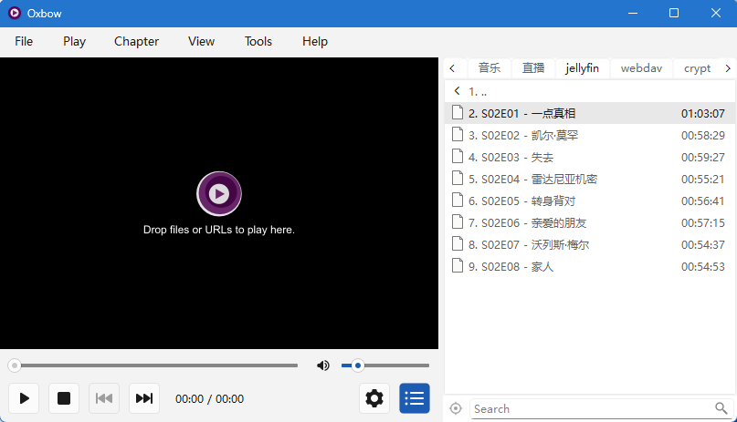
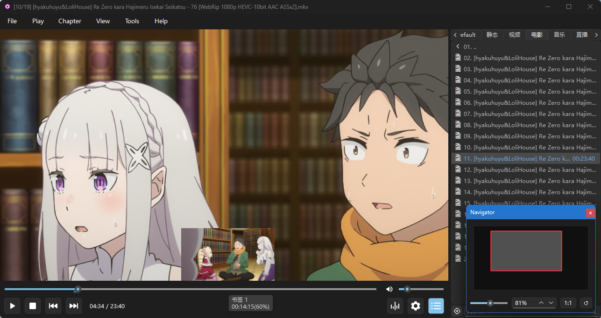
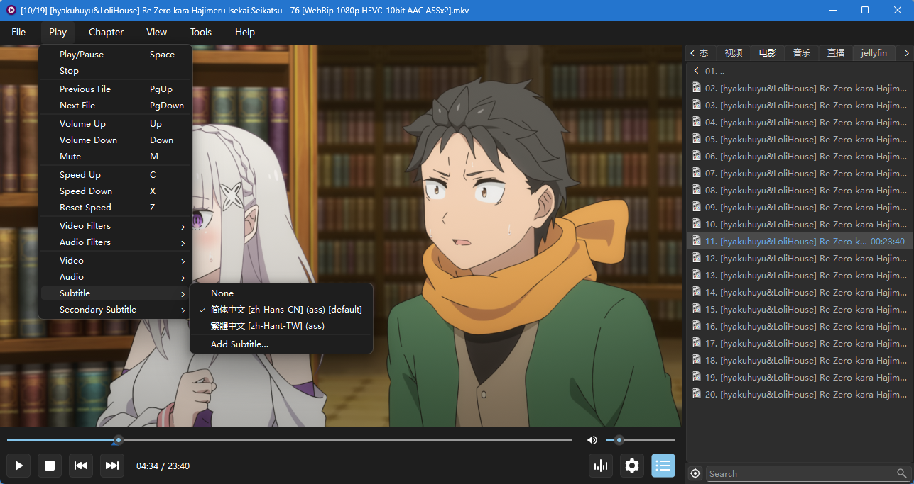
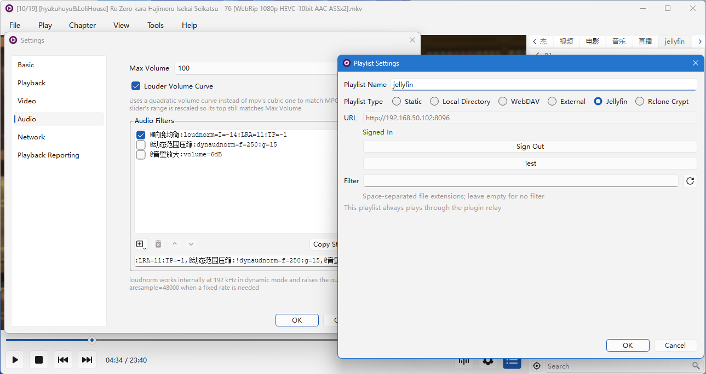
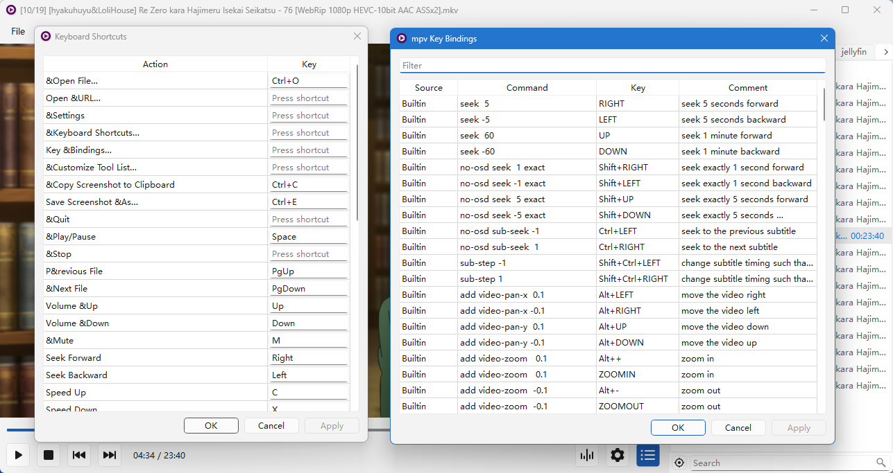
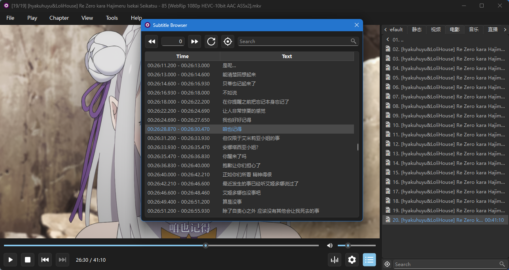

# Oxbow

**English** · [简体中文](README.zh-CN.md)

> A desktop front end for mpv, Qt interface, focused on improving the everyday experience.

## Introduction

Oxbow is a desktop video player for Windows and Linux. The playback engine is [mpv](https://mpv.io/), the interface is built with Qt. It runs as an mpv C plugin, so place the plugin folder in mpv's scripts directory and from then on starting mpv gives you the player with its full interface; the plugin interface is stable, so Oxbow is not re-released for each mpv version and you can pair it with the latest mpv.

Oxbow focuses on improving everyday use, with an interface that is **lean, efficient and unobtrusive** — no overlay-style interface, since anything covering the frame is a distraction while watching.



## Features

- **Multi-tab playlists**: each tab selects its own list source:
  - Static (hand-edited lists);
  - Local directory (bound to a folder, refreshed on demand to show the latest contents);
  - WebDAV (browse directories on a server);
  - External (m3u / txt live sources);
  - Jellyfin (browse media libraries);
  - Rclone Crypt (a folder encrypted by rclone's `crypt` backend — names and content are decrypted on the fly, read-only).
- **Playback reporting**: report playback progress and pause/stop state to media servers. Currently supported:
  - Jellyfin — its Continue Watching row, watched marks and resume points update automatically as you play.
- **Resume memory**: each tab remembers the last played item and playback position, so you pick up where you left off next time.
- **Bookmarks & chapters**: bookmarks can be added with one click and, together with chapters, are marked on the seek bar — click to jump.
- **Hover thumbnails**: resting the cursor on the seek bar shows the frame at that moment. Supported for local files and Rclone Crypt; remote sources are not supported, as fetching a frame costs too much.
- **Mini window mode**: an always-on-top mini window with aspect-locked resizing and automatic edge snapping.
- **Navigator**: like Photoshop's navigator — a viewport rectangle shows what is currently visible; click to jump, drag to pan, scroll to zoom.
- **Subtitle browser**: browse the subtitle track in use — double-click a line to jump to it.
- **Filter editor**: add or remove audio / video filters one by one, taking effect immediately.
- **Volume curve**: the volume mapping can be switched to MPC-HC's quadratic curve instead of mpv's default cubic one, which raises the loudness at low volume levels.
- **mpv key bindings editor**: view and edit `input.conf` visually.
- **Screenshots**: copy to clipboard or save to file.
- **Custom tools**: put frequently used mpv commands in the menu bar; mpv script menus are supported too.
- **Taskbar progress and overlay icon** (Windows only): shows the current playback progress and state in the taskbar.

## Interface screenshots

|  |  |
| --- | --- |
|  |  |
|  |  |
|  | |

## mpv compatibility

Oxbow runs as a plugin inside mpv and has to coexist with other plugins while keeping mpv's own operating conventions intact. It follows these rules:

- **It steps aside instead of fighting for the output window.** On load it reads mpv's `wid` property first; if a window is already assigned — either by the user's `--wid` or because another plugin got there first — Oxbow exits before any initialization, so the two never end up covering each other's output.
- **Keyboard events pass through.** Shortcuts Oxbow claims are handled by itself; every other key is handed back to mpv, so bindings in `input.conf` and mpv's default key map keep working.
- **Mouse events do not pass through.** The mouse is handled entirely by Oxbow's interface and never forwarded to mpv, so mpv-side mouse bindings do not take effect.
- **Script menus are supported.** It reads mpv's `menu-data` property and renders the context menu a script provides into the **Tools** menu.

## Installation

### Prerequisites

- Windows 10 (1809+) or later, 64-bit — this floor comes from Qt 6
- Linux with an X11 session, or a Wayland session with XWayland
- [mpv](https://mpv.io/) — 0.39 or later
- Qt 6.8 or later runtime libraries — bundled with the plugin on Windows, no separate install needed; on Linux the system Qt is used

The video area is embedded through mpv's `wid`, which only exists on the X11 side; pure-Wayland sessions without XWayland are therefore not supported.

### Install the plugin

Download the latest prebuilt package: <https://github.com/wzv5/oxbow-player/releases/latest>; or [build from source](#building-from-source).

The plugin is a folder placed under mpv's script directory on Windows — `<mpv>/portable_config/scripts/oxbow/` for portable mpv, `%APPDATA%/mpv/scripts/oxbow/` for an installed one. A statically linked build (the release package) is a single file:

```text
scripts/oxbow/
├── main.dll        # the plugin — one file does it all
└── MediaInfo.dll   # optional, enables media metadata enrichment
```

A build linked against the shared Qt runtime (from source with `OXBOW_STATIC=OFF`) carries the loader shim and the Qt runtime alongside:

```text
scripts/oxbow/
├── main.dll          # loader shim (loader.dll renamed at deploy time)
├── oxbowcore.dll     # the plugin itself
├── Qt6*.dll, plugins/
└── MediaInfo.dll     # optional
```

```text
~/.config/mpv/scripts/oxbow/             # Linux
└── main.so         # the whole plugin — built from source, copied by hand
```

On Linux, media metadata enrichment depends on the system `libmediainfo`. Without it that feature is unavailable; nothing else is affected.

## Uninstall

**Oxbow is portable**: delete the `scripts/oxbow/` directory and it is gone. All settings and bookmarks live in the single `oxbow.ini` inside that folder and are removed along with it; nothing is written to the registry, nothing is touched system-wide, and mpv itself is unaffected.

## Building from source

### Requirements

- Any toolchain with C++23 support (the Windows target is fully verified, Linux (X11 / XWayland) is supported, other combinations are untested)
- CMake
- Ninja
- Qt 6.8 or later
- No mpv dev package needed — `mpv/client.h` is bundled in the repo
- Linux only: X11 development headers

Optional dependencies:

- libsodium (needed only by the Rclone Crypt backend): on Windows, unpack the official prebuilt package and pass its root directory as `-DLIBSODIUM_ROOT`
- OpenSSL (Linux only, needed only by the Rclone Crypt backend)
- libmediainfo (runtime only, not a build dependency): without it media metadata enrichment is unavailable

libsodium and OpenSSL are not needed with `-DOXBOW_WITH_RCLONE_CRYPT=OFF`.

### Configure and build

Windows:

```bash
cmake -B build -G "Ninja Multi-Config" -DQt6_ROOT="D:/Qt/6.11.2/msvc2022_64" -DMPV_BIN_DIR="D:/path/to/mpv" -DLIBSODIUM_ROOT="D:/path/to/libsodium"
cmake --build build --config Release
```

- `Qt6_ROOT` points at your Qt installation.
- `LIBSODIUM_ROOT` (required on Windows while the Rclone Crypt backend is enabled) points at the root of the unpacked libsodium prebuilt package — it must contain `include/sodium.h` and `x64/<Debug|Release>/<v143>/<static|dynamic>/libsodium.lib`. Configuration stops with a fatal error listing whatever is missing rather than silently degrading into "Rclone Crypt unavailable". With `-DOXBOW_WITH_RCLONE_CRYPT=OFF` this variable is not read at all.
- `MPV_BIN_DIR` (optional, Windows only) points at the directory containing `mpv.exe`. When set, every build automatically deploys the plugin into `portable_config/scripts/oxbow/` next to mpv — ready to run right after building.
- Without `MPV_BIN_DIR`, the artifacts land in `build/Release/` and must be copied manually (see [Installation](#installation)).

Linux (single-config generator; set the build type explicitly, the default is empty):

```bash
cmake -B build -G Ninja -DCMAKE_BUILD_TYPE=Release
cmake --build build
```

No `Qt6_ROOT` or `LIBSODIUM_ROOT` is needed — `find_package` picks up the system Qt, and system libsodium (via pkg-config) and OpenSSL cover the crypto side. The artifact is a single `build/main.so`; copy it to `~/.config/mpv/scripts/oxbow/main.so` (see [Installation](#installation)).

The version number is defined solely in `project(oxbow-player VERSION …)` at the top of `CMakeLists.txt` — bump it by hand and re-configure before each release, so the version baked into the plugin (About dialog / startup diagnostic) matches the release. The commit hash and build time are recomputed on every build automatically.

### Build options

| Option | Default | Description |
| --- | --- | --- |
| `OXBOW_STATIC` | `OFF` | Link Qt and crypto dependencies (libsodium) statically. Smaller footprint, faster startup; recommended — requires a static Qt build and the static libsodium library. **Windows only.** Automatic deployment then ships a single `main.dll` (the core); the loader still gets built but is not deployed. |
| `OXBOW_WITH_RCLONE_CRYPT` | `ON` | Build the Rclone Crypt backend (the rclone `crypt` read-only folder provider). Set to `OFF` to drop it entirely: libsodium and OpenSSL are then not looked for at all and `LIBSODIUM_ROOT` is not needed. |
| `OXBOW_BUILD_TESTS` | `OFF` | Build the unit-test executables. |
| `OXBOW_PUREQT` | `OFF` | Force some features (e.g. the mini window) onto the pure-Qt fallback path (development aid). |
| `MPV_BIN_DIR` | *(empty)* | Directory containing `mpv.exe`; enables automatic post-build deployment. **Windows only** — Linux builds artifacts only. |

## Why the name

This project was started purely to test Ox Alpha's capabilities — the test went so well that it simply grew into a player. The name keeps the ox: an *oxbow* is the U-shaped bow of an ox yoke, the part that fits around the ox's neck and connects its pulling power to the plow — mpv is the ox pulling the cart, and Oxbow is that yoke.

## Acknowledgements

- [mpv](https://mpv.io/) — the playback engine
- [Qt](https://www.qt.io/) — the application framework
- [MediaInfo](https://mediaarea.net/en/MediaInfo) — optional media metadata
- [libsodium](https://libsodium.org/) · [OpenSSL](https://www.openssl.org/) — cryptographic primitives for the Rclone Crypt backend
- [Icons8](https://icons8.com/) — the default icon pack

## License

[GNU General Public License v3.0 or later](LICENSE)
