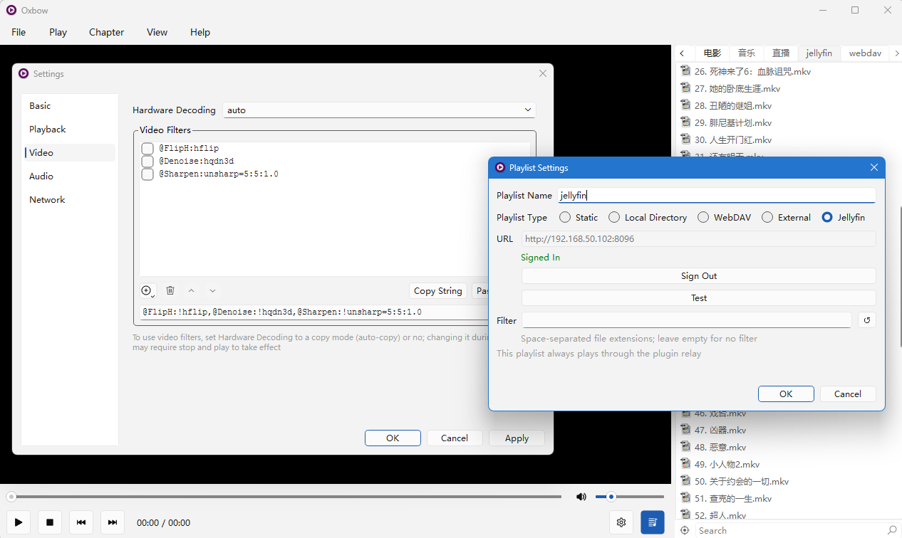

# Oxbow

**English** · [简体中文](README.zh-CN.md)

> A desktop video player powered by mpv — minimal interface, focused on playback itself.

## Introduction

Oxbow is a desktop video player for Windows and Linux: the playback engine is [mpv](https://mpv.io/), the interface is built with Qt. It installs as an mpv plugin — drop it into mpv's scripts directory, and from then on, starting mpv greets you with a full-fledged player interface.

Oxbow's philosophy is simple: **when watching a video, any extra interface is a distraction**. It spends its effort where it matters, adding the conveniences of everyday use: playlist management, bookmarks, mini window, and navigator.



## Features

- **Multi-tab playlists**: each tab picks its own list source:
  - Static (hand-edited lists);
  - Local directory (bound to a folder, refreshed on demand to show the latest contents);
  - WebDAV (browse directories on a server);
  - External (m3u / txt live sources);
  - Jellyfin (browse media libraries);
- **Resume memory**: each tab remembers the last played item and playback position, so you pick up where you left off next time;
- **Bookmarks & chapters**: bookmarks are one click away and, together with chapters, marked right on the seek bar — visible at a glance, click to jump;
- **Mini window mode**: an always-on-top mini window with aspect-locked resizing and automatic edge snapping;
- **Navigator**: a Photoshop-style whole-frame thumbnail — the viewport rectangle shows what is currently visible; click to jump, drag to pan, scroll to zoom;
- **Filter editor**: add or remove audio / video filters one by one, taking effect immediately;
- **Screenshots**: copy to clipboard or save to file with one action.

## Installation

### Prerequisites

- Windows 10 (1809+) or later (64-bit) — this floor comes from Qt 6
- Linux (x86_64) with an X11 session, or a Wayland session with XWayland — the video area is embedded through mpv's `wid`, which only exists on the X11 side; pure-Wayland sessions without XWayland are not supported
- [mpv](https://mpv.io/) — any recent version (all distro builds ship the plugin interface Oxbow needs)

### Install the plugin

Download the latest prebuilt package: <https://github.com/wzv5/oxbow-player/releases/latest>; or [build from source](#building-from-source).

The plugin is a folder placed under mpv's script directory:

```text
<mpv>/portable_config/scripts/oxbow/     # portable mpv (Windows)
%APPDATA%/mpv/scripts/oxbow/             # installed mpv (Windows)
├── main.dll        # plugin entry
├── oxbowcore.dll   # the plugin itself
└── MediaInfo.dll   # optional, enables media metadata enrichment
```

```text
~/.config/mpv/scripts/oxbow/             # Linux
└── main.so         # the whole plugin — built from source, copied by hand
```

On Linux, media metadata enrichment uses the system `libmediainfo` (`libmediainfo0` on Debian/Ubuntu, `mediainfo-libs` on Fedora) when present; without it the feature simply degrades.

Start mpv — the Oxbow window opens automatically.

## Uninstall

**Oxbow is portable**: delete the plugin folder (`scripts/oxbow/`) and it is gone — nothing written to the registry, nothing touched system-wide. All settings and bookmarks live in the single `oxbow.ini` inside that folder and are removed along with it; mpv itself is unaffected.

## Building from source

### Requirements

- Any toolchain with C++23 support should work in theory; the Windows target is fully verified, Linux (X11 / XWayland) is supported — other combinations are untested
- CMake
- Ninja
- Qt 6.x
- No mpv dev package needed — the repo bundles `mpv/client.h`
- Linux only: X11 development headers (`libx11-dev` on Debian/Ubuntu, `libX11-devel` on Fedora) and the Qt 6 development packages (Widgets, Concurrent, Network, LinguistTools)

### Configure and build

Windows:

```bash
cd public
cmake -B build -G "Ninja Multi-Config" -DQt6_ROOT="D:/Qt/6.11.2/msvc2022_64" -DMPV_BIN_DIR="D:/path/to/mpv"
cmake --build build --config Release
```

- `Qt6_ROOT` points at your Qt installation.
- `MPV_BIN_DIR` (optional, Windows only) points at the directory containing `mpv.exe`. When set, every build automatically deploys the plugin into `portable_config/scripts/oxbow/` next to mpv — ready to run right after building.
- Without `MPV_BIN_DIR`, the artifacts land in `build/Release/` and must be copied manually (see [Installation](#installation)).

Linux (single-config generator; set the build type explicitly, the default is empty):

```bash
cd public
cmake -B build -G Ninja -DCMAKE_BUILD_TYPE=Release
cmake --build build
```

No `Qt6_ROOT` is needed — `find_package` picks up the system Qt. The artifact is a single `build/main.so`; copy it to `~/.config/mpv/scripts/oxbow/main.so` (see [Installation](#installation)).

### Build options

| Option | Default | Description |
| --- | --- | --- |
| `OXBOW_STATICQT` | `OFF` | Link Qt statically. Smaller footprint, faster startup; recommended — requires a static Qt build. **Windows only.** |
| `OXBOW_BUILD_TESTS` | `OFF` | Build the unit-test executables; run with `ctest --test-dir build -C <config>`. |
| `OXBOW_PUREQT` | `OFF` | Force some features (e.g. the mini window) onto the pure-Qt fallback path (development aid). |
| `MPV_BIN_DIR` | *(empty)* | Directory containing `mpv.exe`; enables automatic post-build deployment. **Windows only** — Linux builds artifacts only. |

## Linux notes

- **Tested baseline**: *(to be recorded after the first verified run)* — the plugin uses only the standard mpv cplugin interface, which every current distro build provides.
- **KDE / KWin**: KWin ignores the window hints that keep extra buttons off the mini window and may add minimize / maximize buttons to it. A KWin window rule matching `WM_CLASS = oxbow` (force "no border" or "no maximize") hides them; the player itself is unaffected either way.

## Why the name

This project was started purely to test Ox Alpha's capabilities — the test went so well that it simply grew into a player. The name keeps the ox: an *oxbow* is the U-shaped bow of an ox yoke, the part that fits around the ox's neck and connects its pulling power to the plow — mpv is the ox pulling the cart, and Oxbow is that yoke.

## Acknowledgements

- [mpv](https://mpv.io/) — the playback engine
- [Qt](https://www.qt.io/) — the application framework
- [MediaInfo](https://mediaarea.net/en/MediaInfo) — optional media metadata
- [Icons8](https://icons8.com/) — the default icon pack
