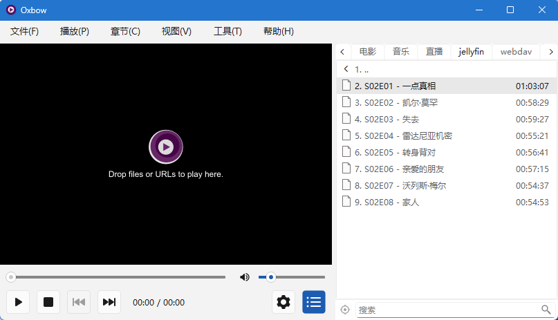
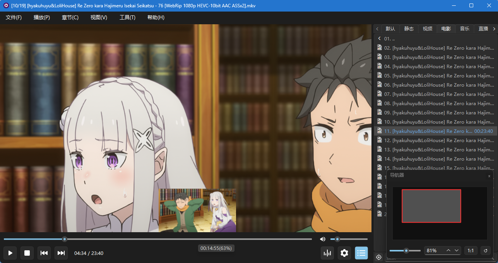
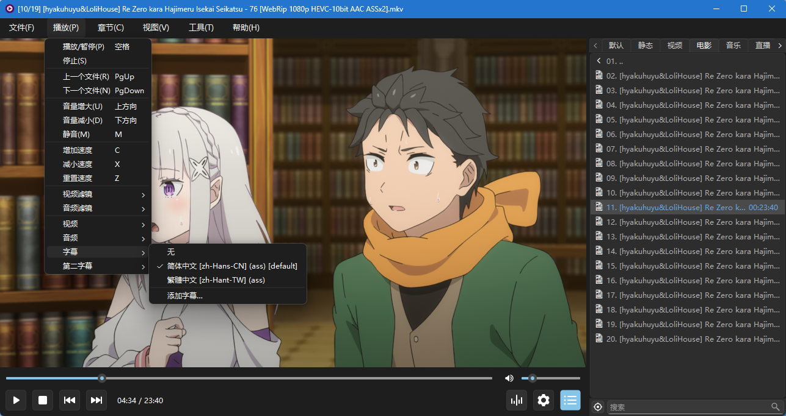
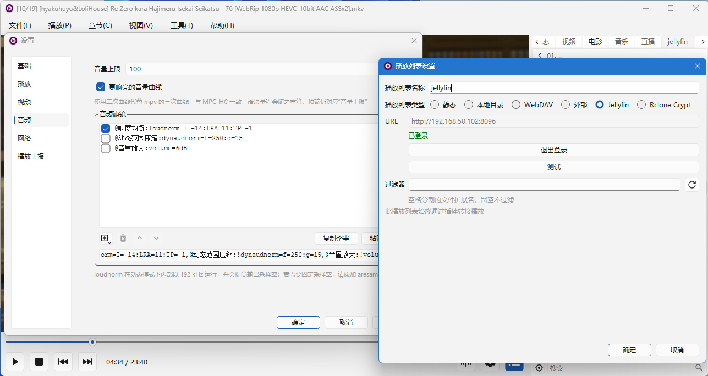
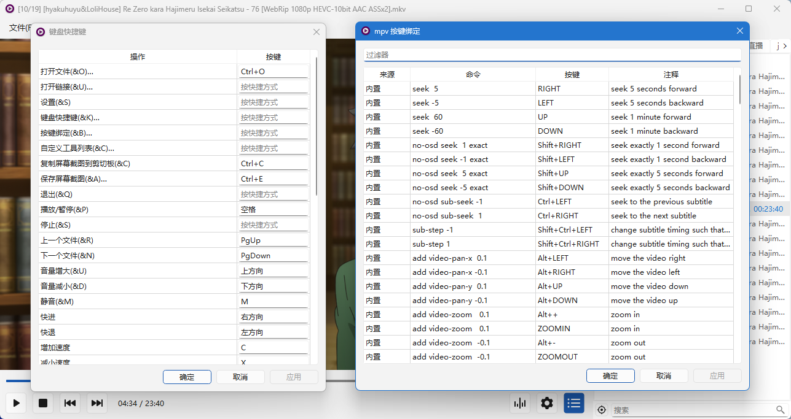
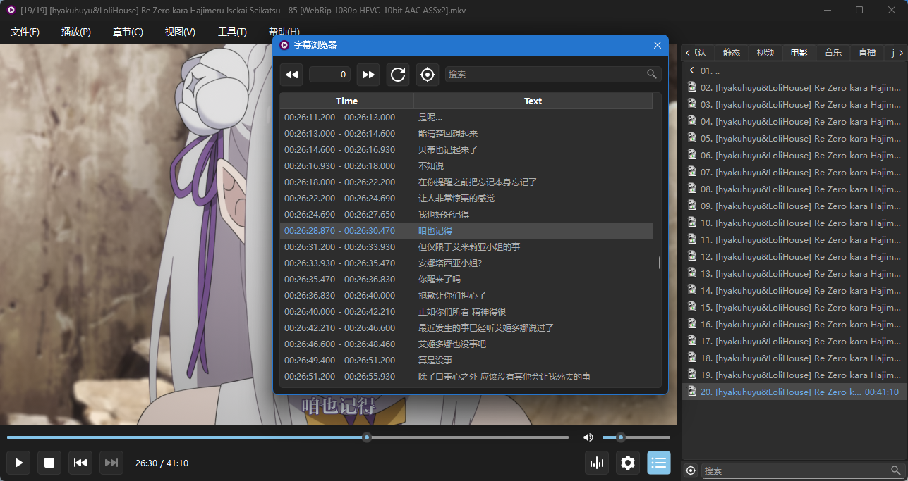

# Oxbow

[English](README.md) · **简体中文**

> mpv 的桌面前端，Qt 界面，专注于改善日常使用体验。

## 简介

Oxbow 是 Windows / Linux 上的桌面视频播放器，播放内核为 [mpv](https://mpv.io/)，界面以 Qt 构建。它以 mpv C 插件的形式运行，把插件目录放进 mpv 的 scripts 目录，之后每次启动 mpv 即为带界面的播放器；插件接口稳定，因此不随 mpv 版本重发，可以随意搭配最新版 mpv 使用。

Oxbow 专注于改善日常使用体验，界面**精简、高效、不打扰**，不做覆盖遮挡式——播放时任何遮挡都是干扰。



## 功能特性

- **多标签页播放列表**：每个标签页独立选择播放列表来源：
  - 静态（手工编辑的清单）；
  - 本地目录（绑定一个目录，按需刷新以显示最新内容）；
  - WebDAV（浏览服务器上的目录）；
  - 外部（m3u / txt 直播源）；
  - Jellyfin（浏览媒体库）；
  - Rclone Crypt（rclone `crypt` 加密的目录，文件名与内容边读边解密，只读）。
- **播放上报**：向媒体服务器回报播放进度与暂停、停止状态。目前支持：
  - Jellyfin——"继续观看"、已看标记与续播点随播放自动更新。
- **续播记忆**：各标签页记录最后播放的条目与播放位置，下次打开从该位置继续。
- **书签与章节**：书签一键添加，与章节一同标记在进度条上，点击即跳转。
- **悬停缩略图**：光标停在进度条上时显示该时刻的画面预览。支持本地文件与 Rclone Crypt；远端源不提供，取帧开销过大。
- **小窗模式**：置顶小窗，等比缩放，靠近屏幕边缘时自动吸附。
- **导航器**：类似 Photoshop 的导航器，以视口矩形示意当前可见范围，支持点击跳转、拖拽平移、滚轮缩放。
- **字幕浏览器**：浏览当前使用的字幕轨，双击跳转到选中句。
- **滤镜编辑器**：音频 / 视频滤镜逐条增删，改动即时生效。
- **音量曲线**：可将音量映射切换为与 MPC-HC 一致的二次曲线，代替 mpv 默认的三次曲线，低音量下的响度更高。
- **mpv 键位编辑器**：以可视化方式查看与编辑 `input.conf`。
- **截图**：复制到剪贴板，或保存为文件。
- **自定义工具**：把常用 mpv 命令放入菜单栏，也支持 mpv 脚本菜单。
- **任务栏进度与覆盖图标**（仅 Windows）：在任务栏中显示当前播放进度及状态。

## 界面截图

|  |  |
| --- | --- |
|  |  |
|  |  |
|  | |

## mpv 兼容性

Oxbow 以插件形式运行在 mpv 中，需要与其他插件共存，同时保留 mpv 自身的操作习惯。为此遵循以下约定：

- **主动避让，不争渲染窗口**：加载时先读取 mpv 的 `wid` 属性。若该属性已有值——用户通过 `--wid` 指定了宿主，或其他插件先行接管——插件在任何初始化之前退出，避免两套输出互相覆盖。
- **键盘透传**：插件认领的快捷键由自身处理；未认领的按键交还给 mpv，因此 `input.conf` 中的自定义绑定与 mpv 默认键位照常生效。
- **鼠标不透传**：鼠标事件由插件界面处理，不转发给 mpv，因此 mpv 侧的鼠标绑定不生效。
- **支持脚本菜单**：读取 mpv 的 `menu-data` 属性，把脚本提供的上下文菜单渲染进「工具」菜单。

## 安装

### 前置条件

- Windows 10（1809+）及以上，64 位——该下限来自 Qt 6
- Linux：X11 会话，或带 XWayland 的 Wayland 会话
- [mpv](https://mpv.io/) 0.39 及以上
- Qt 6.8 及以上运行库——Windows 随插件分发，无需单独安装；Linux 依赖系统 Qt

视频区通过 mpv 的 `wid` 嵌入，该属性只在 X11 一侧存在，因此无 XWayland 的纯 Wayland 会话不受支持。

### 安装插件

下载最新预编译包：<https://github.com/wzv5/oxbow-player/releases/latest>；或从[源码构建](#从源码构建)。

插件是 mpv 脚本目录下的一个文件夹：

```text
<mpv>/portable_config/scripts/oxbow/     # 便携版 mpv（Windows）
%APPDATA%/mpv/scripts/oxbow/             # 安装版 mpv（Windows）
├── main.dll        # 插件入口
├── oxbowcore.dll   # 插件本体
└── MediaInfo.dll   # 可选，启用媒体元数据补全
```

```text
~/.config/mpv/scripts/oxbow/             # Linux
└── main.so         # 整个插件即此文件——从源码构建后手动拷入
```

Linux 上媒体元数据补全依赖系统 `libmediainfo`；缺失时该功能不可用，其余功能不受影响。

## 卸载

**Oxbow 为绿色部署**：删除 `scripts/oxbow/` 目录即完成卸载。全部设置与书签保存在目录内的 `oxbow.ini` 中，随目录一并删除；不写注册表，不改动系统目录，mpv 本身不受影响。

## 从源码构建

### 环境要求

- 支持 C++23 的工具链（Windows 目标已完整验证，Linux（X11 / XWayland）受支持，其他组合未测试）
- CMake
- Ninja
- Qt 6.8 及以上
- 无需 mpv 开发包——`mpv/client.h` 已内置于仓库
- 仅 Linux：X11 开发头文件

可选依赖：

- libsodium（仅 Rclone Crypt 后端需要）：Windows 下解压官方预编译包，将其根目录经 `-DLIBSODIUM_ROOT` 传入
- OpenSSL（仅 Linux，仅 Rclone Crypt 后端需要）
- libmediainfo（仅运行时需要，不参与构建）：缺失时媒体元数据补全不可用

以 `-DOXBOW_WITH_RCLONE_CRYPT=OFF` 关闭 Rclone Crypt 后端时，libsodium 与 OpenSSL 均不需要。

### 配置与构建

Windows：

```bash
cmake -B build -G "Ninja Multi-Config" -DQt6_ROOT="D:/Qt/6.11.2/msvc2022_64" -DMPV_BIN_DIR="D:/path/to/mpv" -DLIBSODIUM_ROOT="D:/path/to/libsodium"
cmake --build build --config Release
```

- `Qt6_ROOT` 指向本机 Qt 安装目录。
- `LIBSODIUM_ROOT`（Windows 且 Rclone Crypt 后端开启时必填）指向解压后的 libsodium 预编译包根目录，其下须有 `include/sodium.h` 与 `x64/<Debug|Release>/<v143>/<static|dynamic>/libsodium.lib`。缺项会在 configure 期带具体路径报错，不会静默退化为"crypt 不可用"。配 `-DOXBOW_WITH_RCLONE_CRYPT=OFF` 时该变量不被读取。
- `MPV_BIN_DIR`（选填，仅 Windows）指向 mpv.exe 所在目录。设置后每次构建自动将插件部署到 mpv 旁的 `portable_config/scripts/oxbow/`，构建完成即可运行。
- 未设置 `MPV_BIN_DIR` 时，产物落在 `build/Release/`，需手动拷贝（见[安装](#安装)）。

Linux（单配置生成器；构建类型须显式指定，默认为空）：

```bash
cmake -B build -G Ninja -DCMAKE_BUILD_TYPE=Release
cmake --build build
```

无需 `Qt6_ROOT` 与 `LIBSODIUM_ROOT`——`find_package` 会命中系统 Qt，加密侧由系统 libsodium（经 pkg-config）与 OpenSSL 覆盖。产物为单个 `build/main.so`，拷至 `~/.config/mpv/scripts/oxbow/main.so` 即可（见[安装](#安装)）。

版本号只定义在 `CMakeLists.txt` 顶部的 `project(oxbow-player VERSION …)`。每次发布前手工递增并重新 configure，插件内嵌的版本（关于对话框 / 启动诊断行）才与发布一致。commit hash 与构建时刻每次构建自动重算，无需干预。

### 构建选项

| 选项 | 默认 | 说明 |
| --- | --- | --- |
| `OXBOW_STATIC` | `OFF` | 静态链接 Qt 与加密依赖（libsodium）。减小体积、加快启动，建议开启——需要静态版 Qt 与预编译包中的静态 libsodium。**仅 Windows。** |
| `OXBOW_WITH_RCLONE_CRYPT` | `ON` | 是否构建 Rclone Crypt 后端（rclone `crypt` 加密目录的只读提供者）。置 `OFF` 时整条撤除：不再查找 libsodium 与 OpenSSL，也不需要 `LIBSODIUM_ROOT`。 |
| `OXBOW_BUILD_TESTS` | `OFF` | 构建单元测试可执行文件。 |
| `OXBOW_PUREQT` | `OFF` | 强制部分功能（如小窗）走纯 Qt 降级路径（开发辅助）。 |
| `MPV_BIN_DIR` | *（空）* | mpv.exe 所在目录；设置后启用构建后自动部署。**仅 Windows**——Linux 只产出文件。 |

## 名字的由来

这个项目最初只是为了测试 Ox Alpha 的能力而建——测完发现能力非常强，索性一路做成了播放器。名字里留下了这头牛：oxbow 本义是牛轭上的 U 形弓板，套在牛颈上、把牛的力气接到犁上的那个部件——mpv 是埋头拉车的牛，Oxbow 就是那副轭。

## 致谢

- [mpv](https://mpv.io/)——播放内核
- [Qt](https://www.qt.io/)——应用框架
- [MediaInfo](https://mediaarea.net/en/MediaInfo)——可选的媒体元数据
- [libsodium](https://libsodium.org/) · [OpenSSL](https://www.openssl.org/)——Rclone Crypt 后端的加密原语
- [Icons8](https://icons8.com/)——默认图标包

## 开源协议

[GNU 通用公共许可证第 3 版或更新版本](LICENSE)
