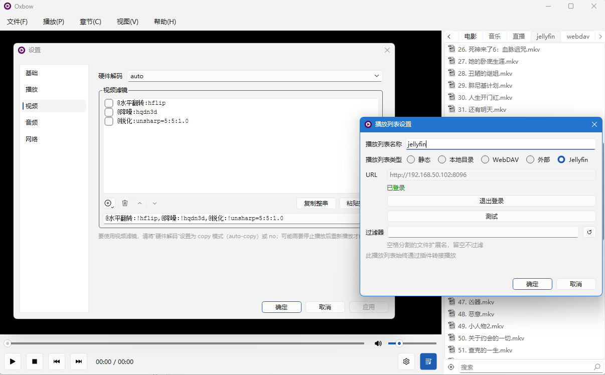

# Oxbow

[English](README.md) · **简体中文**

> mpv 驱动的桌面视频播放器——界面克制，专注播放本身。

## 简介

Oxbow 是一款 Windows / Linux 桌面视频播放器：播放内核是 [mpv](https://mpv.io/)，界面由 Qt 构建。它以 mpv 插件的形式安装——放进 mpv 的 scripts 目录，之后每次启动 mpv，迎接你的都是一个带完整界面的播放器。

Oxbow 的理念很朴素：**看视频时，任何多余的界面都是干扰**。它把力气花在需要的地方，补齐日常使用的便利：播放列表管理、书签、小窗、导航器。



## 功能特性

- **多标签页列表**：每个标签页可各自选择列表来源：
  - 静态（手工编辑的列表）；
  - 本地目录（绑定一个本地目录，随时刷新查看最新内容）；
  - WebDAV（浏览服务器上的目录）；
  - 外部（m3u / txt 直播源）；
  - Jellyfin（浏览媒体库）；
- **续播记忆**：各标签页记住最后播放的条目与进度，下次打开接着看；
- **书签与章节**：书签一键添加，和章节一起标注在进度条上——一眼可见，点击即跳；
- **小窗模式**：全局置顶小窗，等比缩放，屏幕边缘自动吸附；
- **导航器**：类似 Photoshop 导航器的全画面缩略图——视口矩形标注当前可见范围，点击跳转、拖拽平移、滚轮缩放；
- **滤镜编辑器**：音频 / 视频滤镜逐条增删，即改即听即看；
- **截图**：一键复制到剪贴板，或另存为文件。

## 安装

### 前置条件

- Windows 10（1809+）及以上（64 位）——这一下限来自 Qt 6
- Linux（x86_64），X11 会话，或带 XWayland 的 Wayland 会话——视频区经 mpv 的 `wid` 嵌入，只在 X11 一侧成立；无 XWayland 的纯 Wayland 会话不受支持
- [mpv](https://mpv.io/)——任意较新版本（各发行版打包的 mpv 都带 Oxbow 所需的插件接口）

### 安装插件

下载最新预编译包：<https://github.com/wzv5/oxbow-player/releases/latest>；或从[源码构建](#从源码构建)。

插件是放在 mpv 脚本目录下的一个文件夹：

```text
<mpv>/portable_config/scripts/oxbow/     # 便携版 mpv（Windows）
%APPDATA%/mpv/scripts/oxbow/             # 安装版 mpv（Windows）
├── main.dll        # 插件入口
├── oxbowcore.dll   # 插件本体
└── MediaInfo.dll   # 可选，启用媒体元数据补全
```

```text
~/.config/mpv/scripts/oxbow/             # Linux
└── main.so         # 整个插件就是这一个文件——从源码构建后手动拷入
```

Linux 上媒体元数据补全使用系统 `libmediainfo`（Debian/Ubuntu 装 `libmediainfo0`，Fedora 装 `mediainfo-libs`），缺库时该功能自动降级，不影响其余使用。

启动 mpv——Oxbow 窗口自动弹出。

## 卸载

**Oxbow 是绿色的**：直接删除插件目录（`scripts/oxbow/`）即完成卸载——不写注册表、不碰系统目录。全部配置与书签都在目录内唯一的 `oxbow.ini` 里，随之一并删除，mpv 本身不受任何影响。

## 从源码构建

### 环境要求

- 任何支持 C++23 的工具链理论上均可；Windows 目标完整验证过，Linux（X11 / XWayland）受支持——其他组合未测试
- CMake
- Ninja
- Qt 6.x
- 无需 mpv 开发包——仓库内已内置 `mpv/client.h`
- 仅 Linux：X11 开发头文件（Debian/Ubuntu 装 `libx11-dev`，Fedora 装 `libX11-devel`）与 Qt 6 开发包（Widgets、Concurrent、Network、LinguistTools）

### 配置与构建

Windows：

```bash
cd public
cmake -B build -G "Ninja Multi-Config" -DQt6_ROOT="D:/Qt/6.11.2/msvc2022_64" -DMPV_BIN_DIR="D:/path/to/mpv"
cmake --build build --config Release
```

- `Qt6_ROOT` 指向本机 Qt 安装目录。
- `MPV_BIN_DIR`（选填，仅 Windows）指向 mpv.exe 所在目录。设置后每次构建会自动把插件部署到 mpv 旁的 `portable_config/scripts/oxbow/`——构建完即可直接运行。
- 不设 `MPV_BIN_DIR` 时，产物落在 `build/Release/`，需手动拷贝（见[安装](#安装)）。

Linux（单配置生成器；构建类型须显式给，默认为空）：

```bash
cd public
cmake -B build -G Ninja -DCMAKE_BUILD_TYPE=Release
cmake --build build
```

无需 `Qt6_ROOT`——`find_package` 直接命中系统 Qt。产物是单个 `build/main.so`，拷到 `~/.config/mpv/scripts/oxbow/main.so` 即可（见[安装](#安装)）。

发版纪律：版本号单源于 `CMakeLists.txt` 顶部的 `project(oxbow-player VERSION …)`——每次发布前手工 +1 并保证重新 configure，插件内嵌的版本（关于对话框 / 启动诊断行）才与发布对应。commit hash 与构建时刻每次构建自动重算，无需人工干预。

### 构建选项

| 选项 | 默认 | 说明 |
| --- | --- | --- |
| `OXBOW_STATICQT` | `OFF` | 静态链接 Qt。减体积、加快启动，建议开启——需要静态版 Qt。**仅 Windows。** |
| `OXBOW_BUILD_TESTS` | `OFF` | 构建单元测试可执行文件；运行方式 `ctest --test-dir build -C <配置>`。 |
| `OXBOW_PUREQT` | `OFF` | 强制部分功能（如小窗）走纯 Qt 降级路径（开发辅助）。 |
| `MPV_BIN_DIR` | *（空）* | mpv.exe 所在目录；设置后启用构建后自动部署。**仅 Windows**——Linux 只编译产物。 |

## 名字的由来

这个项目最初只是为了测试 Ox Alpha 的能力而建——测完发现能力非常强，索性一路做成了播放器。名字里留下了这头牛：oxbow 本义是牛轭上的 U 形弓板，套在牛颈上、把牛的力气接到犁上的那个部件——mpv 是埋头拉车的牛，Oxbow 就是那副轭。

## 致谢

- [mpv](https://mpv.io/)——播放内核
- [Qt](https://www.qt.io/)——应用框架
- [MediaInfo](https://mediaarea.net/en/MediaInfo)——可选的媒体元数据
- [Icons8](https://icons8.com/)——默认图标包
